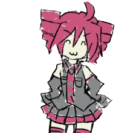

  

  <h1>🖖 hi! i'm LooNuH :3</h1>

  

    

  
  
  

 

## 🍞 a bit about me

- 🎓 studying Electrical Engineering & IoT at UDG, Podgorica
- 💻 fullstack dev — mostly TypeScript, Python and Go these days
- 🔧 i also poke microcontrollers: ESP32, nRF52, bare-metal C, homemade radio protocols
- 🍎 lately way too into Swift and native macOS / iOS apps
- 🤝 building things with my buddy as a two-person team — [MetaStack](https://metastack-dev.github.io)
- 💼 open to junior roles & internships — remote, Montenegro or relocation

## 🎵 what i'm up to rn

| | |
|---|---|
| 🎧 **Loom** | native music player for macOS & iOS — one Swift core, device-to-device sync over Bonjour, Discord Rich Presence |
| 🏨 **SnapCode** | guest services platform for hotels — Next.js, Go, React and FastAPI on one Postgres |
| 🛠️ **freelance** | websites & Telegram Mini Apps for people who ask nicely |

most of it lives in private repos for now, but feel free to ask about it ^^

## 📌 stuff you can poke at

  
  
  
  

## 🧰 things i use

  
   
  
   
  

## 📊 numbers go brrr

  
    
  <picture>
    <source media="(prefers-color-scheme: dark)" srcset="https://raw.githubusercontent.com/LooNuH-dev/LooNuH-dev/output/github-snake-dark.svg" />
    
  </picture>

 

  thanks for stopping by! here, have a baguette 🥖

